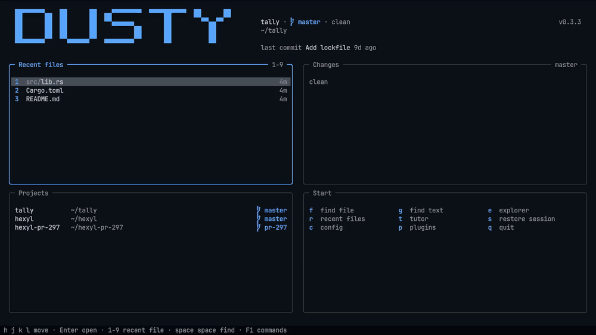
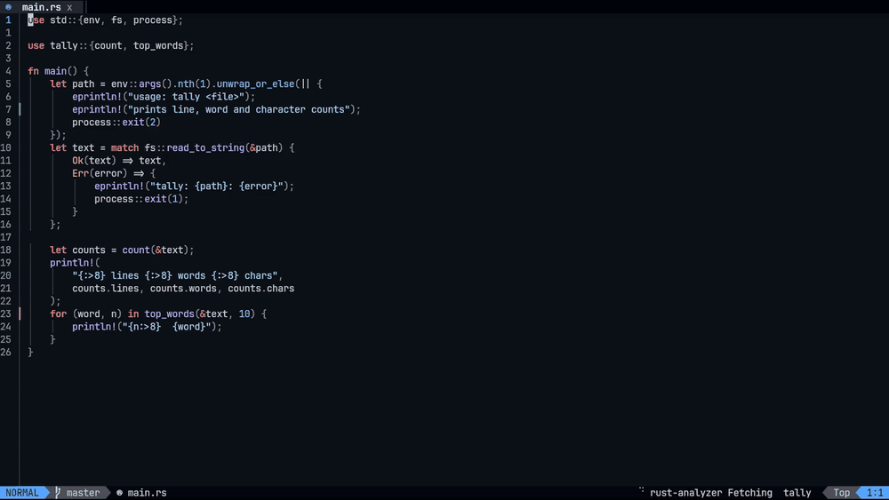
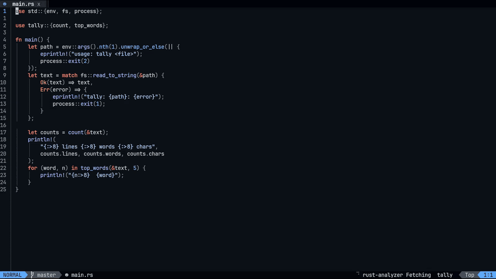
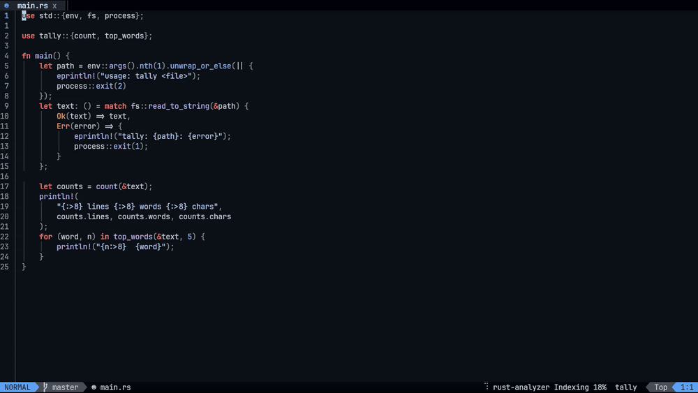

<p align="center">
  <picture>
    <source media="(prefers-color-scheme: light)" srcset="docs/media/dusty-logo-light.svg">
    
  </picture>
</p>

<h3 align="center">Good-looking terminal apps for everything you do while coding.</h3>

<p align="center">
  An editor, a Git client and more to come, sharing one look, one set of keys and one config.<br>
  Install one binary and get to work.
</p>

<p align="center">
  <a href="#install">Install</a> ·
  <a href="#a-quick-look">See it</a> ·
  <a href="#the-apps">The apps</a> ·
  <a href="docs/README.md">Docs</a>
</p>

## Install

```sh
mkdir -p ~/.local/bin
curl -fLo ~/.local/bin/dusty https://github.com/dustyhq/dusty/releases/latest/download/dusty-x86_64-linux
chmod +x ~/.local/bin/dusty && dusty
```

Packages for Debian, Fedora, Arch, AppImage and Flatpak, plus macOS and Windows, are in the [install guide](docs/install.md).

## A quick look

[](docs/media/editing.mp4)

[](docs/media/git.mp4)

<details>
<summary>More: search, language servers</summary>

[](docs/media/search.mp4)

[](docs/media/lsp.mp4)

</details>

## The apps

**Dusty**, the editor. Vim editing with LazyVim's keys out of the box, plus language servers, a debugger, terminals, tasks and tests, and coding agents. Settings are plain TOML, with no Lua to write.

**Dusty Git**, built into the editor (`Space g g`) and also its own app, `dusty-git`. Stage, commit, rebase and browse history, then handle pull requests, issues and CI on GitHub, GitLab, Gitea and Forgejo without leaving the terminal.

**Coming next:** an API client, a database browser, containers and logs.

## License

[GPL-3.0-or-later](LICENSE). The plugin ABI and SDK are Apache-2.0.

<p align="center">
  <a href="docs/install.md">Install</a> ·
  <a href="docs/user-guide-linux.md">User guide</a> ·
  <a href="ARCHITECTURE.md">Architecture</a> ·
  <a href="CONTRIBUTING.md">Contributing</a>
</p>
